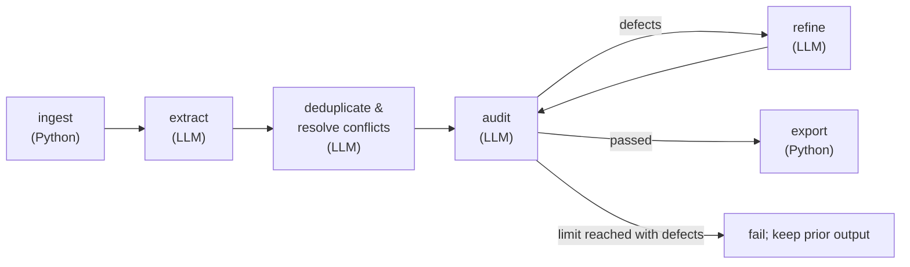

# Requirements Refinement Agentic Network

A [LangGraph](https://langchain-ai.github.io/langgraph/) pipeline that reads a folder of messy project documents (emails, meeting minutes, interviews, surveys, draft specs) and produces one structured requirements document.

Course task: AI4SE Labs 2026, Week 04. See [Task_1.md](Task_1.md) for the assignment.

## How it works (in 30 seconds)



1. **Ingest:** read all `.txt` / `.eml` files and remember where each came from.
2. **Extract:** an LLM pulls out candidate requirements.
3. **Deduplicate:** another LLM merges duplicates, unifies wording, assigns IDs, and moves rejected ideas to a blacklist.
4. **Audit / refine loop:** a third LLM checks quality; a fourth fixes whatever it flags. Repeats until it passes or hits the limit (default 3).
5. **Export:** write `requirements.md` only after the audit passes. An API error or unresolved audit leaves an existing output file intact.

More detail and diagrams: [docs/workflow.md](docs/workflow.md).

## Models

| Node | Model |
|---|---|
| extract | `gpt-5-mini` |
| deduplicate | `gpt-5.4-nano` |
| audit | `gpt-6-luna` |
| refine | `gpt-5.6-luna` |

## Setup

Requires Python 3.12.

```bash
python3.12 -m venv .venv
source .venv/bin/activate
pip install -r requirements.txt
cp .env.example .env      # then put your OPENAI_API_KEY in .env
```

`.env` is git-ignored. Never commit your key.

## Run

```bash
python requirements_agent.py --corpus-dir data/corpus --output-file requirements.md
```

| Flag | Meaning | Default |
|---|---|---|
| `--corpus-dir` | Folder with the input documents (searched recursively) | `data/corpus` |
| `--output-file` | Where to write the Markdown result | `requirements.md` |
| `--max-iterations` | Max audit/refine cycles (≥ 1) | `3` |
| `--mock` | Offline mode, no API calls (for testing only) | off |
| `-v` | Verbose logging | off |

The live pipeline accepts any `.txt` / `.eml` corpus directory. `OPENAI_API_KEY` is required unless `--mock` is set.

## Verify

```bash
python verify_pipeline.py          # 22 checks: ingestion, graph shape, output document
pytest verify_pipeline.py -v       # same checks via pytest
```

## What you get

| File | What it is |
|---|---|
| [requirements.md](requirements.md) | Previous live draft: 69 requirements (`REQ-001…069`), priority scale, source traces, 3 blacklisted proposals (`BLK-001…003`). Its audit did not pass, and it omits the patron-characteristics source. |
| [Task_1_Report.md](Task_1_Report.md) | Short design report |
| [docs/workflow.md](docs/workflow.md) | Diagrams and workflow explanation |
| [requirements_agent.py](requirements_agent.py) | The LangGraph network and CLI |
| [ingest.py](ingest.py) | Deterministic file reader |
| [verify_pipeline.py](verify_pipeline.py) | Automated checks |

## Good to know

- `verify_pipeline.py` checks **structure** (IDs, traces, priority scale, graph shape). It cannot judge whether the requirements are semantically correct or complete, so review the output yourself.
- `--mock` uses test data for the example corpus. It is for testing, and a live run never silently switches to it.
