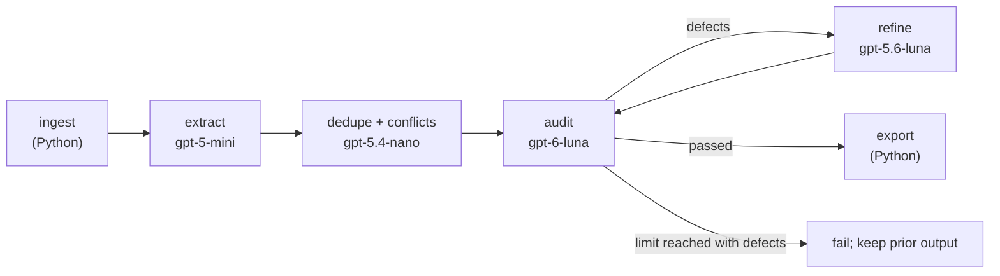

# Task 1 Report: Requirements Refinement Agentic Network

**Goal:** turn a folder of messy project documents into one clean, traceable requirements specification, using a LangGraph network of LLM and non-LLM nodes.

**Input:** 20 files for the PINES/Evergreen library system (12 email threads, meeting minutes, interviews, a survey, a draft SRS, a reference doc).
**Output:** [requirements.md](requirements.md), a previous live draft with 69 requirements and 3 blacklisted proposals. Its live audit ended with unresolved issues; it has not been approved by the network.

Diagrams and a step-by-step walkthrough: [docs/workflow.md](docs/workflow.md).

---

## 1. Why a network instead of one prompt?

One big prompt over ~40k tokens of mixed documents tends to miss minority opinions, invent features, lose track of sources, and ignore contradictions. Splitting the work into focused steps, with a checker that can send work back, avoids that.

## 2. Design

| Node | Type | Responsibility |
|---|---|---|
| `ingest_corpus` | Python | Recursively reads `.txt`/`.eml`, splits email threads, records each file's relative path. |
| `extract_requirements` | LLM | Extracts candidates in batches; ignores small talk (pets, food, office chatter). |
| `resolve_conflicts_and_deduplicate` | LLM | Merges duplicates, unifies terminology, assigns `REQ-###` IDs, moves rejected or conflicting ideas to the blacklist. |
| `audit_requirements` | LLM + rules | Checks IDs, title and paragraph length, priority validity, sources. Outputs pass/fail and issues. |
| `refine_requirements` | LLM | Rewrites flagged requirements or blacklist items and can merge duplicate IDs, then returns to the audit. |
| `export_markdown` | Python | Writes the final Markdown. |

LLM nodes first request Pydantic-validated structured output. If a structured call fails, the node retries with a JSON prompt. A live call that still fails stops the run; offline fixtures are used only with `--mock`.

## 3. Model choices

Models are matched to the job, using four different ones from the allowed list.

| Node | Model | Why |
|---|---|---|
| extract | `gpt-5-mini` | Cheap, fast, good recall over many documents. |
| dedupe | `gpt-5.4-nano` | Lightweight comparison and merging. |
| audit | `gpt-6-luna` | Strongest model in the list, used as the critic. |
| refine | `gpt-5.6-luna` | Careful rewriting without drifting from the source. |

## 4. Feedback loop

The auditor checks the document. If it finds defects and `iteration_count < max_iterations` (default 3), the refiner fixes flagged requirements or blacklist items and the auditor re-checks. Each pass increments the counter. If defects remain at the limit, the run fails and preserves any previous output file.

## 5. How each spec is covered

### Network specs

| Spec | How it is met |
|---|---|
| ANS1 – 3+ LLM nodes | 4 LLM nodes (extract, dedupe, audit, refine) |
| ANS2 – 1+ deterministic node | `ingest_corpus`, `export_markdown` |
| ANS3 – feedback loop | `audit_requirements` ⇄ `refine_requirements` via `should_refine`, bounded by a counter |
| ANS4 – 3+ models | 4 different models, one per LLM node |
| ANS5 – LangGraph | `StateGraph(AgentState)` |

### Output specs

| Spec | What does the work | Where to see it in `requirements.md` |
|---|---|---|
| OS1 single document | Exporter writes one Markdown file | Whole file |
| OS2 unique IDs | Dedupe node assigns `REQ-###`/`BLK-###`; auditor checks uniqueness | `REQ-001…069`, `BLK-001…003` |
| OS3 no duplicates | Dedupe node merges overlaps | Section 3 |
| OS4 tracing | Ingest records paths; extraction and dedupe keep and merge them; auditor requires sources | `Sources` line on every requirement |
| OS5 name + paragraph | Extraction schema requires title and paragraph; auditor checks length | Each requirement entry |
| OS6 priority + scale | Schema requires MoSCoW priority; exporter prints the scale | Section 2 |
| OS7 consistency | Dedupe prompt unifies vocabulary and flags conflicts; auditor reviews | Whole file |
| OS8 completeness | Batched extraction over all files | 19 of 20 files cited; source coverage alone does not prove requirement completeness |
| OS9 blacklist | Dedupe node moves rejected items out with reasons | Blacklist section |

## 6. Blacklisted proposals

These were seriously discussed but rejected, so they are recorded with reasons instead of being silently dropped:

- **BLK-001** Mandatory magnetic card-swipe login as the only authentication
- **BLK-002** Unanonymized patron demographic reporting at individual level
- **BLK-003** Denormalized reporting warehouse required as a hard constraint

## 7. Verification

`verify_pipeline.py` runs 22 automated checks. The saved draft passes 21; the coverage check fails because `conv_pines023_patron_characteristics.eml` is not cited:

- **Ingestion (6):** file discovery, email splitting, paths, dates, error handling.
- **Graph (7):** compiles, 4 LLM nodes, 2 deterministic nodes, a cycle with a counter guard, allowed and varied models.
- **Output (9):** one document, unique IDs, title overlap, valid traces, paragraph length, priority scale, blacklist, corpus coverage. The corpus coverage check currently fails.

The pipeline accepts a corpus path; the provided example shaped some prompts and mock fixtures. A small live run is described in the separate validation report.

## 8. Limitations

- The checks verify **structure**, not meaning. They cannot confirm a requirement is correct or that nothing was missed, so a human review of `requirements.md` is still needed.
- `--mock` uses built-in sample data for the provided corpus. It is for testing only.
- The saved document was generated before the latest fixes, and its last live audit still had 16 issues. Passing structural checks does not remove those unresolved findings.
- The old draft omits the consolidated patron-characteristics discussion, including configurable age ranges and combined demographic filters. A full rerun is needed before submission.
- LLM output varies between runs, so a new run will not reproduce the exact same document.
