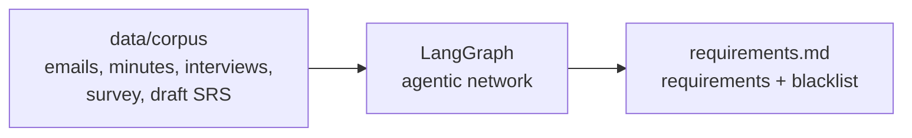
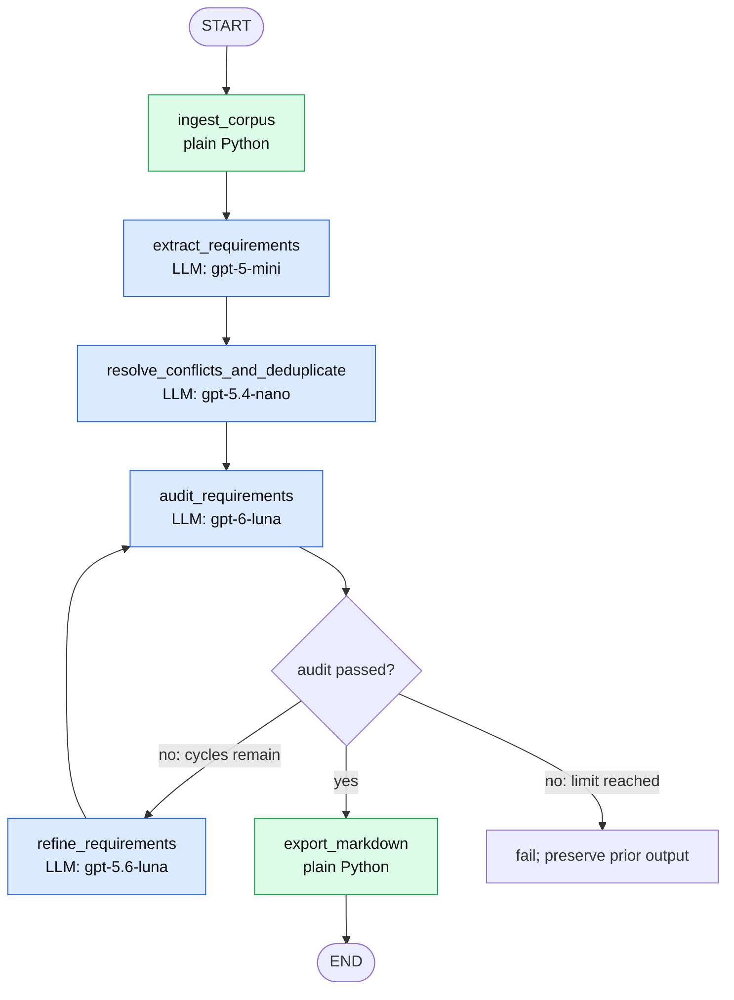
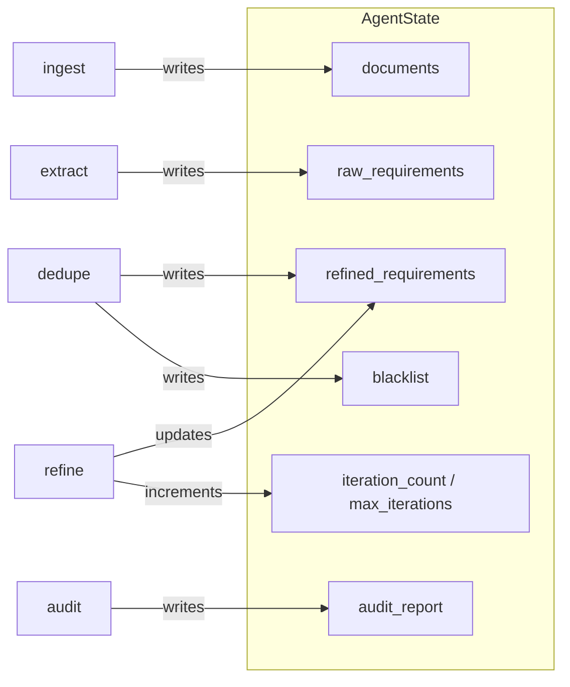
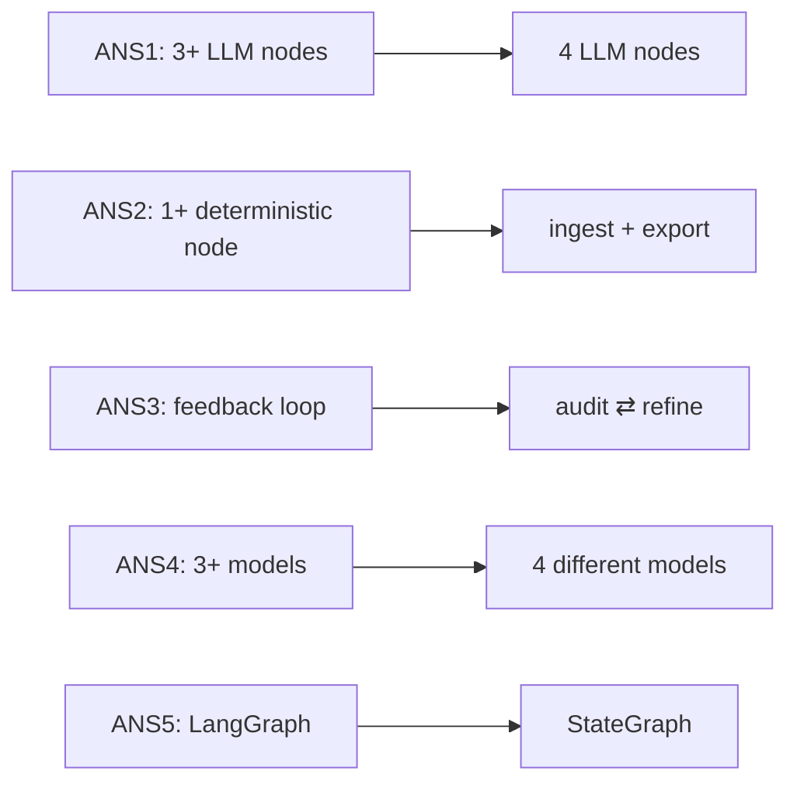

# How the Network Works

A short, visual walkthrough. All diagrams are [Mermaid](https://mermaid.js.org/) and render on GitHub and in most Markdown viewers.

## 1. The big picture

Raw project documents go in. One structured requirements document comes out.



## 2. The graph

Six nodes. Four call an LLM, two are plain Python.



Blue = LLM node, green = deterministic node.

## 3. What each node does

| Node | Type | Job |
|---|---|---|
| `ingest_corpus` | Python | Finds every `.txt` / `.eml` file, splits email threads, records each file's relative path so every requirement can be traced back. |
| `extract_requirements` | LLM | Reads documents in batches and pulls out candidate requirements (title, paragraph, priority, sources). Skips small talk. |
| `resolve_conflicts_and_deduplicate` | LLM | Merges duplicates, unifies vocabulary, assigns `REQ-###` IDs, moves rejected or contradictory ideas to the blacklist (`BLK-###`). |
| `audit_requirements` | LLM + rules | Checks quality: unique IDs, paragraph length, valid priority, sources present. Returns pass/fail and a list of issues. |
| `refine_requirements` | LLM | Fixes flagged requirements or blacklist items, merges duplicate IDs when needed, then sends them back for another audit. |
| `export_markdown` | Python | Renders the final Markdown file. |

## 4. The feedback loop

The auditor and refiner go back and forth until the document passes or the iteration limit (default 3) is hit. At the limit, unresolved defects fail the run.

```mermaid
sequenceDiagram
    participant Aud as audit_requirements
    participant Ref as refine_requirements
    participant Exp as export_markdown

    Aud->>Aud: check all requirements
    alt defects and iteration < max
        Aud->>Ref: issues (e.g. "REQ-005 too short")
        Ref->>Ref: rewrite only flagged items, iteration += 1
        Ref->>Aud: updated requirements
    else passed
        Aud->>Exp: final requirements + blacklist
    else limit reached with defects
        Aud-->>Aud: stop with an error; keep prior output
    end
```

## 5. Shared state

Every node reads and writes one shared state object (`AgentState`):



## 6. How the course specs are covered



For the output specs (OS1–OS9) see the table in [`../Task_1_Report.md`](../Task_1_Report.md).
